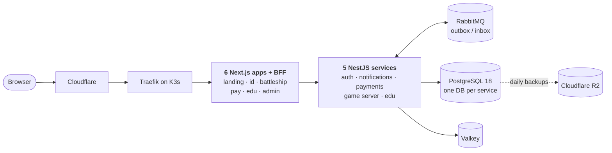

# outegro.dev

**A real production platform, designed, built and operated end-to-end by one engineer — from the first pixel to the cluster.**

---

## What this is

outegro.dev is my portfolio — not as a set of screenshots, but as a running system. Six web apps share one account, one payment flow, one notification pipeline and one operator console, all deployed through GitOps to a Kubernetes cluster I set up and maintain myself.

Everything here is live. You can sign in, play, buy, read — and every step goes through the same services described below.

## Live apps

| | App | What it does |
|---|---|---|
| 🗞️ | **[outegro.dev](https://outegro.dev)** | Landing in a hand-made zine style, EN/RU, strict CSP, CLS ≈ 0 |
| 🔑 | **[id.outegro.dev](https://id.outegro.dev)** | Single sign-on for the whole platform: email code, passkeys (WebAuthn), Google, sessions and security log |
| ⚓ | **[battleship.outegro.dev](https://battleship.outegro.dev)** | Real-time multiplayer Battleship: matchmaking by Elo, private rooms, 4 bot levels, leaderboard, shop |
| 📚 | **[edu.outegro.dev](https://edu.outegro.dev)** | Interactive books on Node.js and SQL internals: quizzes, an event-loop simulator, an in-browser SQL sandbox, AI helper |
| 💳 | **[pay.outegro.dev](https://pay.outegro.dev)** | Checkout, subscriptions, receipts and refunds for every app on the platform |
| 🛠️ | **admin.outegro.dev** | Operator console: users, roles, grants, audit log, payments, content, Grafana via SSO *(private)* |

## Architecture

## Engineering highlights

- **Identity done properly.** OAuth 2.0 SSO with PKCE across subdomains, ES256 JWTs with key rotation and JWKS, a backend-for-frontend so tokens never reach the browser, passkeys, Google with account linking, CSRF checks, rate limits backed by Valkey.
- **Services that own their data.** Each NestJS service has its own PostgreSQL database and role. Services talk through RabbitMQ events with a transactional outbox and an idempotent inbox, retries via TTL queues and dead-letter queues.
- **Payments you can trust.** Checkout, webhooks, reconciliation, subscriptions, refunds and entitlement grants; duplicate purchases are detected and flagged, revoking a grant cancels renewal at the provider.
- **A server-authoritative game.** Battleship runs on WebSockets with the rules engine shared between client and server, turn timers, forfeits that survive a restart, and a probability-map bot at the top level.
- **Ship in minutes, roll back with `git revert`.** CI checks and rebuilds only affected apps, pushes images to GHCR and commits tags to [gitops](https://github.com/outegro-dev/gitops); Argo CD runs migrations and rolls out. A one-service change reaches production in about 6 minutes.
- **Operated, not just deployed.** Prometheus, Loki and Grafana; structured logs with correlation IDs; a watchdog that sends alerts to Telegram; Sealed Secrets in git; a tested restore from backup in 81 seconds.
- **Tested end to end.** 1,600+ automated tests: unit, integration on Testcontainers against real PostgreSQL, Valkey and RabbitMQ, and Playwright across Chromium, Firefox and WebKit with axe accessibility checks.

## By the numbers

<table>
  <tr>
    <td align="center"><b>6</b> web apps</td>
    <td align="center"><b>5</b> backend services</td>
    <td align="center"><b>9</b> shared packages</td>
    <td align="center"><b>1,600+</b> automated tests</td>
    <td align="center"><b>~6 min</b> merge → production</td>
    <td align="center"><b>81 s</b> verified restore</td>
  </tr>
</table>

## Stack

**Frontend** — Next.js 16 · React 19 · TypeScript 6 · Tailwind CSS 4 · Radix UI · MobX · next-intl · Three.js / R3F 
**Backend** — Node.js 24 · NestJS 12 · Zod 4 · Drizzle ORM · WebSockets · jose · SimpleWebAuthn 
**Data & messaging** — PostgreSQL 18 (CloudNativePG) · Valkey 9 · RabbitMQ 4 · Cloudflare R2 
**Infrastructure** — K3s · Traefik · cert-manager · Argo CD · Sealed Secrets · GitHub Actions · Docker Buildx Bake · Cloudflare 
**Observability** — Prometheus · Grafana · Loki + Alloy · Pino 
**Quality** — Vitest · Testcontainers · Playwright · axe-core · Biome · pnpm + Turborepo

The reasoning behind every choice is on [outegro.dev/stack](https://outegro.dev/stack).

## Repositories

| Repository | |
|---|---|
| **[platform](https://github.com/outegro-dev/platform)** | Monorepo with all apps, services and shared packages, CI, specs and ADRs |
| **[gitops](https://github.com/outegro-dev/gitops)** | Desired state of the production cluster: Argo CD apps, platform components, node bootstrap |

## Built by

**Nick Lukashik** — senior full-stack engineer, Tbilisi.

